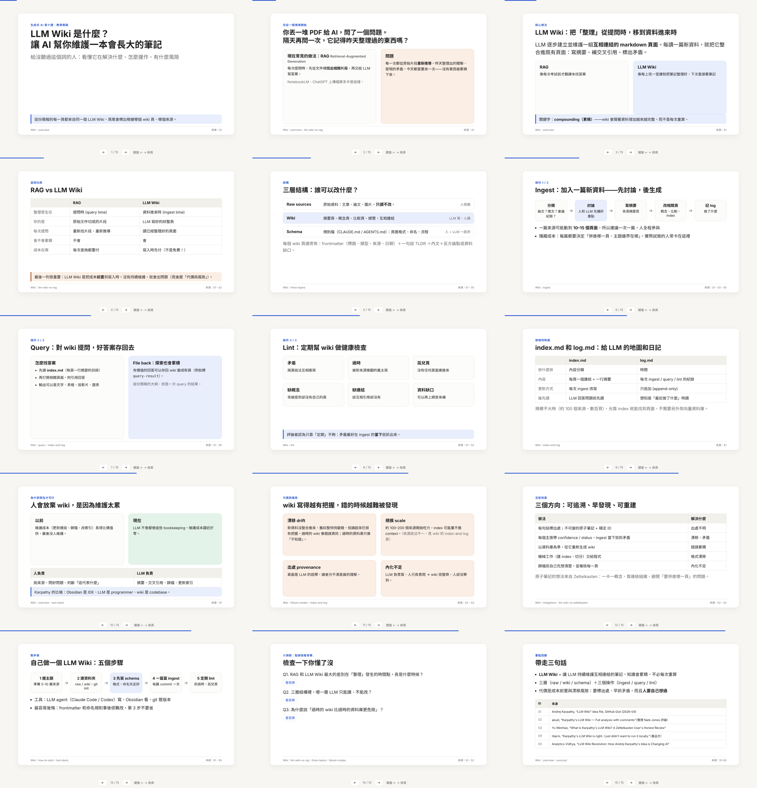
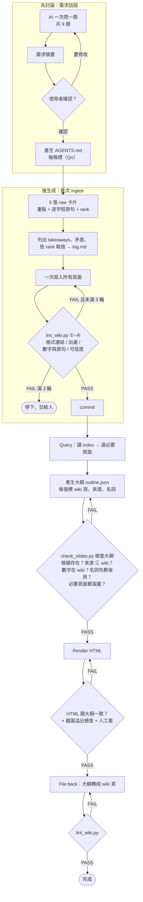

## 中央 112502505 資工三A 王昭尹 LLM Wiki：用 LLM Wiki 教「LLM Wiki 是什麼」

### 1. LLM Wiki 主題與簡介

**主題：LLM Wiki 本身**——Karpathy 2026 年 4 月提出的 pattern：讓 LLM 持續維護一組互相連結的 markdown 頁，知識會累積，不像 RAG 每次提問都重算。

選這個主題的原因：作業要用 LLM Wiki 做事，順便把「這個方法本身好不好用」也研究清楚，做完的反思就直接是 wiki 內容的實例（例如 wiki 裡寫的「漂移」「出處不明」，在做簡報時真的遇到了）。

| 項目 | 數量 | 說明 |
|---|---|---|
| Ingest 來源 | 5 篇 | 原始提案 1、評論 2、實作教學 1、產品文 1，刻意放一篇可信度低的產品文測試可信度規則 |
| Wiki 頁面 | 28 頁 | 10 概念 + 10 主張 + 5 來源摘要 + 1 查詢結果 + index/log；頁面類型由需求訪談決定（只有三種） |
| 英文原句 | raw 19 句、wiki 用到 17 句 | 每句 ≤ 15 字，lint 逐字比對 raw 卡片。驗證程度：2 句有別的來源交叉確認、3 句兩次擷取一致、14 句只擷取一次 |
| 來源間矛盾 | 1 處 | index.md 能撐多大：S1 說約 100 個來源內就夠、S2/S5 說 100–200 頁就塞爆 → 依可信度採信 S1，其他列註記 |

| ID | 來源 | 類型 |
|---|---|---|
| S1 | [Karpathy, LLM Wiki idea file](https://gist.github.com/karpathy/442a6bf555914893e9891c11519de94f) | 原始提案 |
| S2 | [aksel, Full analysis with comments](https://aksel.mataroa.blog/blog/karpathys-llm-wiki-full-analysis-with-comments/)（Nate Jones 評論 + 留言） | 評論 |
| S3 | [Yu Wenhao, A Zettelkasten User's Honest Review](https://yu-wenhao.com/en/blog/karpathy-zettelkasten-comparison/) | 比較 |
| S4 | [Hjarni, Karpathy's LLM Wiki is right…](https://hjarni.com/blog/karpathys-llm-wiki-is-right.md) | 產品文（可信度低） |
| S5 | [Analytics Vidhya, LLM Wiki Revolution](https://www.analyticsvidhya.com/blog/2026/04/llm-wiki-by-andrej-karpathy/) | 實作教學 |

### 2. LLM Wiki 成果

| 路徑 | 內容 |
|---|---|
| [llm-wiki/AGENTS.md](llm-wiki/AGENTS.md) | 規則檔 v2：依需求訪談產生，每條規則標〔Qn〕對應訪談題號；CLAUDE.md 只寫 `@AGENTS.md` |
| [llm-wiki/interview/](llm-wiki/interview/) | 9 題訪談紀錄、確認過的需求摘要、v1 規則檔（對照組） |
| [llm-wiki/raw/](llm-wiki/raw/) | 5 張 source card：URL、可信度 rank、改寫過的重點、逐字短原句（附驗證程度）；不放原文全文 |
| [llm-wiki/wiki/index.md](llm-wiki/wiki/index.md) | 入口目錄 |
| [llm-wiki/wiki/log.md](llm-wiki/wiki/log.md) | 每次 ingest 的「討論 → 變更 → Lint」紀錄 |

Wiki 的規則：每條 bullet 都要標來源 `[S1]`，推論要寫「（推論）」，頁面用 `[[頁名]]` 互連。

#### 先討論、後生成：需求訪談 → AGENTS.md

照講義的開場 prompt，先不建任何檔案：AI 一次問一題，共 9 題，整理成需求摘要，我確認後才產生 AGENTS.md。第 9 題是 AI 發現我第 4 題（每句標出處）和第 8 題（lint 沒選檢查出處）互相矛盾，回頭追問的。

一開始沒經過訪談、AI 一次寫出的規則檔留下來當對照組（[schema-v1-one-shot.md](llm-wiki/interview/schema-v1-one-shot.md)），兩份比較：

| 面向 | v1：一句話生成 | v2：討論後生成 | 差異 |
|---|---|---|---|
| 讀者 | 沒寫（預設給人看） | 主要給 AI 讀 → 格式固定、好解析 | v1 沒想到 |
| 頁面類型 | 5 種（含比較頁、名詞表） | 3 種：來源、概念、主張；不要比較頁 | 改變結構 |
| 語言 | 沒寫 | 中文 + 英文原句（逐字、≤ 15 字） | v1 沒想到 |
| 矛盾處理 | 並列兩方、不裁決 | **依可信度取捨** | **相反** |
| Ingest | 一次一篇 | **批次** | **相反** |
| 產出 | 沒寫 | 只為簡報服務 | v1 沒想到 |
| Lint | 格式、連結、出處 | 再加原句逐字比對、可信度取捨方向 | 加嚴 |

8 個面向裡，v1 有 3 個根本沒寫、2 個跟我真正要的相反。v1 其實是把 Karpathy 原文的預設值照抄一遍，看起來很完整，但那是 Karpathy 的需求，不是我的。

### 3. 教學 HTML 簡報

**連結：** https://77joywang77.github.io/1151-GenAI-W10-HW/slides/
（檔案：[slides/index.html](slides/index.html)，單一 HTML，鍵盤 ← → 換頁）

| 段落 | 投影片 | 教學目的 |
|---|---|---|
| 引入 | 1–4 | 從「上傳 PDF 問 AI」切入，先懂 RAG，才知道 LLM Wiki 在改什麼 |
| 結構與操作 | 5–9 | 三層、ingest / query / lint、index 與 log |
| 為什麼可行 / 風險 | 10–12 | 不只講優點：漂移、規模、出處、內化不足，以及改善方法 |
| 動手 / 測驗 / 回顧 | 13–15 | 五步驟、3 題點擊看答案、來源列表 |

**Wiki ↔ 簡報對應**：每張投影片都有 `data-wiki`（根據哪幾頁）和 `data-src`（引用哪些來源），頁尾也看得到。完整對應表存回 wiki：[queries/teaching-deck-outline.md](llm-wiki/wiki/queries/teaching-deck-outline.md)。



### 4. Loop / Graph 設計



| 問題 | 答案 |
|---|---|
| 哪些步驟會重複？ | ① 訪談：沒確認就回去改；② 寫入 ↔ lint，最多 3 輪；③ 大綱 ↔ 檢查、render ↔ 檢查 |
| 哪些地方要檢查 / 重生？ | 需求摘要（人確認）、寫入 wiki 後（lint ①–④）、大綱完成後（grounding + 教學順序）、HTML 完成後（一致性 + 7 種尺寸版面）、file back 後（再 lint） |
| 什麼時候停？ | lint 改滿 3 輪還沒過就停，把剩下的錯交給人；資料不足時寫「資料缺口」，不用 AI 自己的知識補 |
| 為什麼這樣設計？ | 依 wiki 自己整理出的風險：**漂移與出處不明** → 每條都標來源、數字要能在來源找到；**矛盾要當下抓** → 討論放在生成前；**機械工作交給程式** → lint、對應表都用腳本 |

**分工**：「討論 / 生成 / 大綱 / HTML」由 LLM agent（Claude）依 AGENTS.md 執行；所有檢查都是可重跑的 Python 腳本（[tools/](tools/)），不讓 LLM 自己判斷自己對不對。

```bash
python tools/lint_wiki.py                                              # 檢查 wiki
python tools/check_slides.py slides/outline.json                       # 檢查大綱
python tools/check_slides.py slides/index.html --outline slides/outline.json  # 檢查 HTML
python tools/outline_to_wiki.py                                        # file back
```

### 5. 實際執行紀錄

完整輸出在 [run-log/](run-log/)（23 份），重點如下。01–17 是第一版規則（v1），19–23 是訪談後依 AGENTS.md v2 重建：

| # | 節點 | 結果 | 發生什麼事 |
|---|---|---|---|
| 01–05 | 每篇 ingest 後 lint | 全 PASS | warnings 從 4 降到 0（還沒 ingest 的來源一篇篇補上） |
| 06–07 | 加數字 grounding | PASS；自我測試抓到 2 個埋的錯 | 結構 lint 全過不代表內容對，所以補數字檢查，並故意埋錯確認它真的會抓 |
| 08 | 人工複核 | 改 1 處 | **lint 盲點：表格不檢查**。比較表寫 Zettelkasten「人為主」，S3 沒這樣說 |
| 09 | 檢查 HTML（v1） | FAIL 6 | 4 個是檢查器誤判（序號、日期）；另外發現日期讓「11」永遠通過的漏判 |
| 11 | 修檢查器後重跑 | FAIL 5 | 5 個全是**寫投影片時自己加的**：編造數字、錯的來源對應 |
| 12–13 | 改成先檢查大綱（v2） | PASS | 大綱過了才 render，HTML 與大綱一致 |
| 14–15 | file back 後 lint | FAIL 13 → PASS | 投影片編號被當成數字主張，改生成器拿掉編號 |
| 16–17 | 視覺檢查 | 0 溢出；人工改 1 處 | 腳本說沒問題，但截圖看得出雙欄卡片被拉長留白 → 改 CSS |
| 18 | 版面（小視窗） | 修正前 820×600 有 14/15 張跑版 → 7 種尺寸全 ok | 原本只測 1280×800 一種尺寸；改成整張等比例縮放 |
| 19 | v2 批次 lint 第 1 輪 | FAIL 12 | 6 處產品文說法沒標「（廠商觀點）」：v1 規則寫得鬆，舊頁面被 v2 新規則抓出來 |
| 20 | 第 2 輪 | FAIL 4 | 只剩大綱連到已刪除的比較頁，留到簡報階段修 |
| 21 | v2 lint 自我測試 | 埋 3 錯全抓到 | 改一個字的原句、拿掉廠商標記、把可信度取捨反過來 |
| 22–23 | 簡報改接後全部重跑 | PASS | 第 11 張「規模」改成跟 wiki 的取捨一致；手機頁尾換行蓋到內容 → 修 |

v1 slide check 的錯誤（run-log/11）：

```
ERROR slide 01: 數字 15 不在 wiki 頁 ['overview'] 中          ← 「15 分鐘看懂」是自己編的
ERROR slide 02: 數字 10 不在 wiki 頁 [...] 中                 ← 「10 份 PDF」情境數字
ERROR slide 04: 數字 11 不在 wiki 頁 ['llm-wiki-vs-rag'] 中   ← 寫死「見第 11 頁」，換順序就錯
ERROR slide 14: 沒有標 data-wiki                              ← 測驗頁的答案沒有根據
ERROR slide 15: 引用 ['S3','S4','S5']，但對應的 wiki 頁沒有    ← 回顧頁只對應 overview
```

### 6. 反思

**最常出錯的節點：「寫投影片」**。建 wiki 的 5 輪 lint 都一次 PASS，但第一次寫 HTML 就有 5 個真正的錯。原因是寫 wiki 時有 CLAUDE.md 規定每條都要標來源，寫簡報時目標變成「讓初學者看得懂」，就會自然加上「15 分鐘」「10 份 PDF」這種好懂但 wiki 裡沒有的東西——這正是 wiki 裡 S2 說的漂移：讀起來很合理，但沒有出處。

第二常出錯的其實是**檢查器本身**：序號、日期造成誤判，日期還造成漏判（frontmatter 的 2026-11-21 讓任何「11」「21」都過關）。只看 PASS 不夠，所以後來每加一條規則都先埋錯測試。

**檢查往前移到哪裡：從「HTML 完成後」移到「大綱完成後」**。5 個錯都是規劃時就決定的（這張根據哪頁、要不要舉數字），等 HTML 寫完才查，修一個就要重寫 HTML。改成 outline.json 先檢查，HTML 只負責排版，再用 `--outline` 確認 render 沒偷改根據。

**有沒有改 workflow / graph：有，改了三處**

| 改動 | 原因 |
|---|---|
| 簡報流程加「大綱 → 檢查」節點（v1 → v2） | 錯誤源頭在規劃，越晚查越貴 |
| wiki lint 加數字 grounding + 人工複核節點 | 結構檢查全過，內容仍可能錯；表格是腳本的盲點，要靠人看 |
| file back 的頁面由腳本生成 | 大綱和 wiki 頁手寫兩份一定會不一致，機械工作交給程式（呼應 wiki 的 mitigations 頁） |

**建 Wiki 時特別考量的事**

| 考量 | 結果 |
|---|---|
| 先討論再生成 | 9 題訪談讓規則檔有 2 處跟 AI 預設相反（矛盾處理、ingest 方式）。如果沒問，AI 會照 Karpathy 的習慣做，我自己也不會發現 |
| 批次 ingest 的代價 | 講義和 Karpathy 都建議一次 1–2 篇。我選批次比較快，代價是矛盾和舊頁面的問題最後一起爆出來：第 1 輪 lint 一次 12 個錯，一篇篇做的 v1 每輪都是 0 |
| 依可信度取捨 | 規則簡單、AI 好執行，但 rank 高不代表對：index 規模那題，評論者的說法可能比較貼近實務。所以 wiki 保留「註記」，簡報也把另一方的說法寫出來 |
| 英文原句 | 想讓 AI 能拿原文驗證，結果發現 shell 下載不到原文，只能用 WebFetch 擷取。19 句裡只有 2 句能用別的來源交叉確認（約 1/10），所以每句都標了驗證程度，不假裝全部驗證過 |

**說明**：主題、放置方式、9 題訪談的答案由我決定；v1 時期 5 篇來源的 takeaways 由 LLM 提出，記在 [log.md](llm-wiki/wiki/log.md)。raw 資料夾只放改寫過的重點和 15 字以內的短原句，沒有放原文全文。
